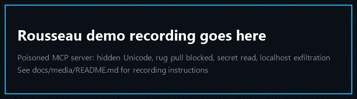
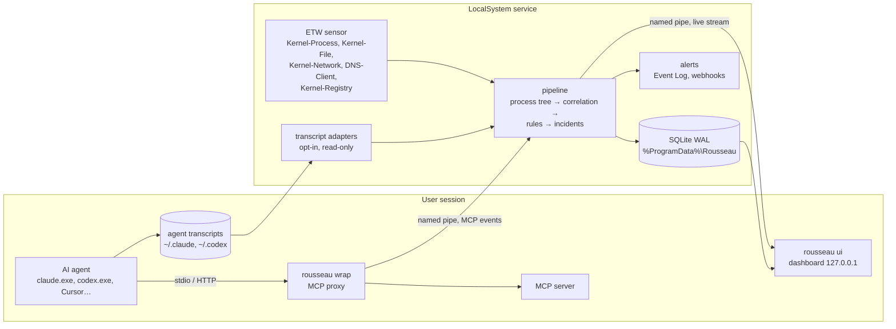
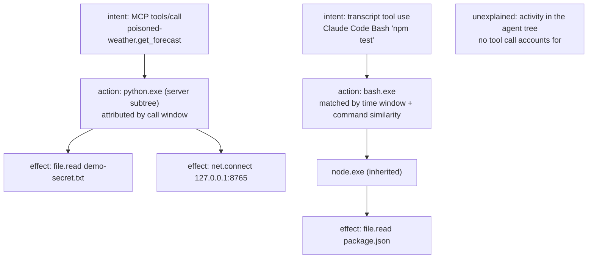

# Rousseau

**Endpoint detection and response for AI coding agents on Windows: OS-level ground truth plus MCP intent, on one causal timeline.**

[](https://github.com/ide-bloom/rousseau/actions/workflows/ci.yml)
[](https://github.com/ide-bloom/rousseau/releases)
[](https://pypi.org/project/rousseau-lab/)
[](LICENSE)



> The GIF above is a placeholder until the demo is recorded. To record it: build a release binary, run the [poisoned-server scenario](examples/README.md) in enforce mode, and capture the dashboard's Sessions view (ScreenToGif or the Windows Snipping Tool's recorder), then save it as `docs/media/demo.gif`. See [docs/media/README.md](docs/media/README.md).

Rousseau is part of **Palisade**, a toolkit for developer security in the AI-agent era, with [Epicurus](https://github.com/ide-bloom/epicurus) and [Hush](https://github.com/ide-bloom/hush).

---

## Why Rousseau exists

AI coding agents (Claude Code, Codex, Cursor, Windsurf, Gemini CLI, Copilot agent mode, Aider, OpenCode, Goose…) run on your machine with your permissions. They read files, run shell commands and call tools exposed by MCP servers, which makes them a new attack surface:

- More than 30 CVEs were filed against MCP servers, clients and tooling in January and February 2026 alone.
- Tool poisoning, rug pulls (a server changing its tool definitions after approval), tool shadowing and hidden-Unicode prompt injection are documented in the [OWASP MCP Top 10](https://owasp.org/www-project-mcp-top-10/) and the [OWASP Top 10 for Agentic Applications (2026)](https://genai.owasp.org/resource/owasp-top-10-for-agentic-applications/).

Several open-source proxies already inspect MCP JSON-RPC traffic. They share a blind spot: **an agent's built-in tools (its shell, file edits, web fetch) never go through MCP**, and a JSON-RPC proxy cannot see what a tool call actually did on the machine.

Rousseau combines two layers of visibility:

1. **OS-level ground truth**: ETW telemetry on every process, file, network, DNS and registry action taken by an agent's entire process tree.
2. **Intent**: the MCP traffic between agents and their servers, plus (opt-in) the agent's own local session transcript, so each OS action traces back to the tool call that caused it.

Everything lands on one timeline (tool call → process started → files read → network connection), evaluated by detection rules built for agents. Rousseau can alert, block an MCP tool call, or (opt-in) suspend a process tree. It is strictly defensive and fully local: nothing leaves the machine unless you configure an alert channel.

## How it works





- **Agent discovery**: an embedded [signature table](crates/rousseau-adapters/src/agents.toml) (executable names, path and command-line patterns, Authenticode signer) marks agent processes as roots. Every descendant inherits the label; PIDs are tracked with their start time so reused PIDs never inherit a label.
- **MCP layer**: `rousseau wrap` relays stdio byte-for-byte and records `initialize`, `tools/list`, `tools/call`, resources, prompts, sampling, elicitation and list-changed notifications. Tool definitions are pinned by canonical-JSON SHA-256 (trust on first use, or strict). Inspectors look for hidden Unicode (Tags, zero-width, bidi, variation-selector smuggling, with the hidden text decoded), instruction-like content, confusable tool names across servers, secrets, exfiltration-shaped URLs and dangerous argument patterns.
- **Correlation**: an MCP call's in-flight window plus the server's process subtree attributes OS events to that call; a transcript tool use is matched to the shell process it spawned; everything else is *unexplained*, itself a useful signal. See [docs/correlation.md](docs/correlation.md).
- **Detection**: 35 built-in YAML rules mapped to the OWASP Agentic Top 10 (2026) and MITRE ATT&CK, with event, sequence, threshold and first-seen detections. See [docs/rules.md](docs/rules.md).

## Quick start

Requirements: Windows 11 (24H2 or later), x64 or arm64. Download a release zip (verify it against `SHA256SUMS` and the build-provenance attestation), or build from source with `cargo build --release`.

```powershell
# 1. From an elevated terminal: install the LocalSystem sensor service.
rousseau install

# 2. As yourself: route your agents' MCP servers through Rousseau.
rousseau protect --dry-run      # show what would change
rousseau protect                # rewrite configs (timestamped backups)

# 3. Open the dashboard.
rousseau ui
```

New installs start in **observe** mode. Switch to `alert` or `enforce` in the dashboard's Settings once you are happy with what you see. `rousseau unprotect` restores every config file byte for byte, as long as the file has not been edited since; if it has, the entries are unwrapped in place and the backup is kept.

No admin rights? `rousseau run` works without elevation too, with the ETW sensor off: you still get MCP findings, pinning, blocking and transcripts, but not file, network or registry effects.

### Try the demo

```powershell
.\target\release\rousseau.exe run --mode enforce --agents examples\scenarios\demo-agent.toml   # elevated
python examples\scenarios\rousseau-demo-agent.py --rousseau .\target\release\rousseau.exe
```

The poisoned server ([examples/poisoned-mcp-server](examples/poisoned-mcp-server)) only reads `demo-secret.txt` in its own folder and only talks to a listener on `127.0.0.1`.

## CLI reference

| Command | Purpose |
|---|---|
| `rousseau install` / `uninstall [--purge]` | Register or remove the LocalSystem service (copies `rousseau.exe` to `%ProgramFiles%\Rousseau`, restricts `%ProgramData%\Rousseau` to SYSTEM, Administrators and you, registers the Event Log source) |
| `rousseau run [--mode M] [--headless] [--no-browser] [--port N] [--agents FILE]` | Sensors, rules and dashboard in the foreground |
| `rousseau ui [--port N] [--no-browser]` | Dashboard connected to the running sensor (shows toasts for new incidents) |
| `rousseau wrap --name NAME [--mode M] -- CMD ARGS…` | Run a stdio MCP server through the proxy |
| `rousseau wrap-http --name NAME --upstream URL [--port N]` | Local reverse proxy for a Streamable HTTP MCP server (point the client at the printed `http://127.0.0.1:N/mcp`) |
| `rousseau protect [--project DIR]… [--dry-run]` / `unprotect [--dry-run]` | Rewrite or restore MCP client configs (Claude Desktop, Claude Code, Cursor, VS Code, Windsurf, Codex, Gemini CLI) |
| `rousseau doctor` | Check privileges, service, pipe, ETW session and lost events, storage, rules, running agents, MCP configs and transcript adapters |
| `rousseau export --session ID\|latest -o FILE` | Write a portable `.rousseau` bundle ([format](docs/bundle-format.md)) |
| `rousseau replay BUNDLE` | Read-only dashboard over a bundle |
| `rousseau rules list` / `rules validate PATH…` | List or validate rules |
| `rousseau agents` | List running agents recognised by the signature table |
| `rousseau resume PID…` | Resume processes suspended by an enforce-mode rule |

Global options: `--data-dir DIR` (or `ROUSSEAU_DATA_DIR`), `-v`/`-vv`. Logs go to stderr (`ROUSSEAU_LOG` accepts `tracing` filter syntax); the service logs to `rousseau-service.log` in the data directory.

### Configuration

`%ProgramData%\Rousseau\rousseau.toml` (the dashboard's Settings page edits the common keys):

```toml
retention_days = 14
rule_dirs = []          # extra rule directories
agent_files = []        # extra agent signature files
classifier = false      # on-device prompt-injection classifier (builds with --features ml)

[response]
mode = "observe"        # observe | alert | enforce
allow_suspend = false   # let enforce-mode rules marked suspend_tree suspend agent trees
block_findings_at = "high"

[pinning]
strict = false          # new servers' tools need approval

[transcripts]           # opt-in, read-only
claude_code = false
codex = false

[alerts]
min_severity = "medium"
toast = true
eventlog = true
# discord_webhook = "https://discord.com/api/webhooks/…"
# slack_webhook = "https://hooks.slack.com/services/…"
# webhook_url = "https://siem.example.com/rousseau"
# webhook_secret = "…"   # HMAC-SHA256 key: header X-Rousseau-Signature = sha256=HMAC(secret, "<timestamp>.<body>")
```

## Writing rules

Rules are Sigma-inspired YAML. A credential read followed by an outbound connection from the same agent tree within 60 seconds:

```yaml
id: LOCAL-001
title: Credential read then egress
severity: critical
description: An agent tree read SSH keys and then connected to a public address.
owasp: [ASI02, ASI03]
mitre: [T1552.004, T1041]
falsepositives: [git over SSH (exclude ssh.exe)]
detection:
  type: sequence
  by: [lineage.root]
  within: 60s
  steps:
    - where: {all: [{descendant_of_agent: true}, {field: kind, equals: file.read}, {field: file.path, glob: "*/.ssh/id_*"}]}
    - where: {all: [{field: kind, equals: net.connect}, {field: net.remote_scope, equals: public}]}
```

Field matchers (`equals`, `contains`, `startswith`, `endswith`, `glob`, `regex`, `in`, `exists`, `gt`/`gte`/`lt`/`lte`), lineage predicates (`descendant_of_agent`, `spawned_by_mcp_server`), and `event`, `sequence`, `threshold` and `first_seen` detections are documented in [docs/rules.md](docs/rules.md); event fields are in [docs/event-schema.md](docs/event-schema.md). Validate with `rousseau rules validate my-rules/` and test offline with `rousseau-lab test-rule`.

## rousseau-lab

[`rousseau-lab`](lab/README.md) is a Python package for detection engineers and incident responders: `pip install rousseau-lab`.

```bash
rousseau-lab load session.rousseau                     # summary statistics
rousseau-lab report session.rousseau -o report.html    # self-contained offline HTML report
rousseau-lab test-rule my-rule.yaml --against *.rousseau
rousseau-lab hunt *.rousseau --query "kind = 'file.read' and file.path ~ '.ssh'"
rousseau-lab synth --scenario poisoned-server -o synthetic.rousseau
```

Its rule engine implements the same semantics as the Rust engine; both run the shared [conformance suite](conformance/README.md).

## Threat model and limitations

Full details in [docs/threat-model.md](docs/threat-model.md). In short:

- **Admin-level malware can blind Rousseau.** ETW sessions can be stopped or tampered with by anything running as administrator or SYSTEM. Rousseau reports lost events and a missing session (`rousseau doctor`, dashboard health, Event Log id 3000) but is not a kernel-protected EDR.
- **Transcript formats can change.** Adapters parse defensively and switch themselves off (with a health warning) when a line cannot be parsed, rather than guessing.
- **Unknown tools are invisible as intent.** An agent can use tools Rousseau has no adapter for; their OS effects still appear, as *unexplained* activity.
- **Agents launched outside known signatures are not tracked** unless you add a signature. IDE hosts (VS Code, Cursor, Windsurf) mix human and agent activity in one process tree.
- **User-level code can talk to the pipe.** The named pipe accepts MCP events from the installing user's processes (never OS telemetry), so a process running as you could inject fake MCP events.
- **Blocking covers MCP calls.** Built-in tool calls cannot be blocked before they run; enforce mode can suspend the offending process tree afterwards (opt-in).

## Comparison with MCP-only proxies

| Capability | MCP-only proxies | Rousseau |
|---|---|---|
| Inspect MCP JSON-RPC (tool poisoning, secrets, hidden Unicode) | Yes (core feature) | Yes |
| Pin tool definitions / detect rug pulls | Many do | Yes (TOFU or strict, diff + approve/deny) |
| Block MCP calls | Many do | Yes (enforce mode) |
| See what a tool call did on the OS (processes, files, network, registry) | No | Yes (ETW) |
| See agent built-in tools (shell, file edits) | No | Yes (OS effects; intent via opt-in transcripts) |
| Attribute OS effects to the causing tool call | No | Yes |
| Platform | Usually cross-platform | Windows 11 only |
| Privileges | User | Admin for the ETW service |

MCP-only proxies are lighter, cross-platform and often cover more MCP transports and policy languages. Rousseau trades that for OS-level visibility on Windows. They can be combined: Rousseau wraps whatever command the client launches.

## FAQ

**Does Rousseau send anything to the cloud?** No. Alerts go only to channels you configure. The optional classifier downloads its model once from a pinned Hugging Face revision and verifies its SHA-256.

**Will it slow my agent down?** The stdio proxy relays bytes as they arrive (tool lists are pinned before being relayed). ETW callbacks drop events from untracked processes after a hash lookup. The budget is under 3% CPU and 150 MB RAM; see [docs/performance.md](docs/performance.md) for the methodology.

**Can I use it without `rousseau protect`?** Yes: wrap individual servers by hand (`"command": "rousseau.exe", "args": ["wrap", "--name", "x", "--", "npx", "my-server"]`), or rely on ETW alone.

**What about remote (HTTP) MCP servers?** `protect` lists them but cannot rewrite a URL into a process. Run `rousseau wrap-http --name x --upstream https://… --port 8931` and point the client at `http://127.0.0.1:8931/mcp`.

**Is the classifier required?** No. It is optional (`cargo build --features ml`, `classifier = true`, plus an `onnxruntime.dll` via `ORT_DYLIB_PATH`). The heuristic inspectors are always on.

## Roadmap

- Sign release binaries (Authenticode) in addition to build-provenance attestations.
- Protected Process Light / ETW-TI integration for tamper resistance (requires a Microsoft-signed component).
- More transcript adapters (Gemini CLI, Cursor) as their local log formats stabilise.
- MCP policy rules (argument allow-lists per tool) in the rule engine.
- Optional export to OpenTelemetry / SIEM formats.

## Security, license

Report vulnerabilities privately as described in [SECURITY.md](SECURITY.md). Licensed under the [Apache License 2.0](LICENSE).
